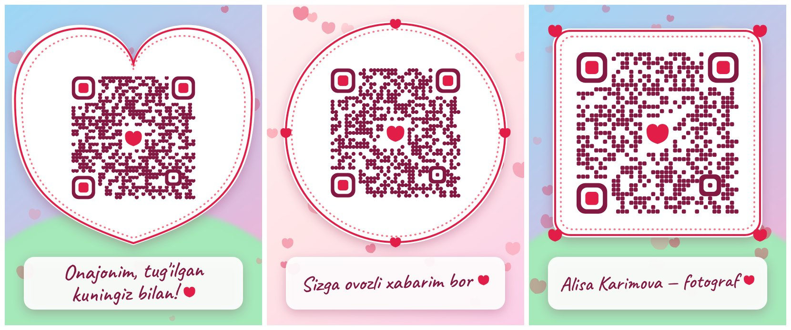

# BirQR — Telegram bot

Har kim botda **o'z profilini ochadi**, unga **rasm, video, ovozli xabar, dumaloq video, havola, matn** va boshqalarni joylaydi.
Bot ularni foydalanuvchining **shaxsiy yopiq guruhiga saqlab boradi** va **yurakchali QR karta** beradi.
Kim QR kartani skanerlasa, Telegramda o'sha odamning profili (yoki bitta ovozli xabari) ochiladi.



## Qanday ishlaydi

1. Foydalanuvchi botga `/start` yozadi → ismi va o'zi haqida qisqacha yozadi.
2. Bot undan **shaxsiy yopiq guruh** ochib, botni unga qo'shishni so'raydi — ma'lumotlar tarqab ketmasligi uchun.
   Botga yuborilgan hamma narsa o'sha guruhga nusxalanib boradi. Guruhga o'zi yuborgan narsalar ham profilga qo'shiladi
   (buning uchun bot guruhda admin bo'lishi kerak). Ochiq (public) guruhga bot ulanmaydi.
3. Botga istalgan narsani yuboradi — hammasi profiliga qo'shiladi:
   🖼 rasm · 🎬 video · 🎞 GIF · 🎵 audio · 🎙 ovozli xabar · ⭕️ dumaloq video · 📄 fayl · 🔗 havola · 📝 matn · 👤 kontakt · 📍 joylashuv
4. «🔳 QR karta» tugmasini bosadi → bot chiroyli QR karta yasaydi:
   - QR nuqtalari **yurakcha**, karta **❤️ yurak, ⚪️ doira yoki ⬛️ kvadrat** ramka ichida;
   - pastki oq joyda **qo'lda yozilgandek tilak** (foydalanuvchi o'zi yozadi, ❤️ emojisi yurakcha bo'lib chiziladi);
   - orqa fonda **xira rasm yoki video kadri** (foydalanuvchi o'zi yuboradi, bo'lmasa profilidagi rasm olinadi);
   - chop etish uchun 2160×2700 PNG fayl ham beriladi.
5. **Ovozli xabar yoki dumaloq video** yuborilsa, bot darhol shu xabarning **alohida QR kartasini** beradi
   (dumaloq videoning o'z kadri fon bo'ladi). Sovg'aga yopishtirish uchun qulay: skanerlagan odam
   «🎁 … sizga ovozli xabar qoldirdi» deb o'sha xabarni eshitadi.

Qo'shimcha imkoniyatlar:

- 📋 **Elementlarim** — har bir element uchun QR karta, tartibini o'zgartirish (⬆️) va o'chirish (🗑)
- ⚙️ **Sozlamalar** — ism, tavsif, profil rasmi, shaxsiy guruhni ulash/uzish, profilni o'chirish
- 👀 Profil va har bir xabar necha marta ko'rilganini hisoblaydi
- Instagram, Telegram, YouTube, TikTok va boshqa saytlar avtomatik taniladi

Fayllar serverga yuklab olinmaydi — Telegram'ning o'zida saqlanadi, bot faqat ularning ID'sini eslab qoladi
(QR karta foni uchungina kichik rasm vaqtincha yuklanadi).

QR kartalar ikki xil skaner algoritmi (jsQR va ko'p Android ilovalaridagi ZXing) bilan avtomatik sinovdan o'tkaziladi: `npm test`.

## Ishga tushirish

### 1. Bot yaratish

Telegramda [@BotFather](https://t.me/BotFather) ga yozing → `/newbot` → bot nomi va username kiriting.
BotFather sizga **token** beradi (masalan `123456789:AAH...`).

### 2. Kompyuterda yoki serverda

[Node.js](https://nodejs.org) **22.13** yoki undan yangi versiyasi kerak.

```bash
npm install
```

```bash
cp .env.example .env
```

`.env` faylini oching va `BOT_TOKEN=` dan keyin tokeningizni yozing. So'ng:

```bash
npm start
```

Konsolda `✅ Bot ishga tushdi: https://t.me/...` chiqsa — tayyor. Botingizga kirib `/start` bosing.

### 3. Doimiy ishlashi uchun (server)

Bot 24/7 ishlashi uchun uni serverda (VPS, Railway, Render va h.k.) ishga tushiring.

**pm2 bilan:**

```bash
npm install -g pm2
```

```bash
pm2 start index.js --name birqr --node-args="--disable-warning=ExperimentalWarning"
```

**Docker bilan:**

```bash
docker build -t birqr .
```

```bash
docker run -d --name birqr --restart unless-stopped -e BOT_TOKEN=TOKENINGIZ -v birqr-data:/app/data birqr
```

> ⚠️ `data/` papkasida ma'lumotlar bazasi saqlanadi. Server qayta ishga tushganda o'chib ketmasligi kerak
> (Docker'da `-v` bilan volume ulang, Railway/Render'da "persistent disk/volume" qo'shing).

## Sozlamalar (`.env`)

| O'zgaruvchi | Tavsif | Standart |
|---|---|---|
| `BOT_TOKEN` | @BotFather bergan token | — (majburiy) |
| `DATA_DIR` | Ma'lumotlar bazasi papkasi | `./data` |
| `MAX_ITEMS` | Bitta profilga nechta element qo'shish mumkin | `50` |

## Tuzilishi

```
index.js        — ishga tushirish (token, bot menyusi)
src/bot.js      — botning barcha xabarlari, tugmalari va shaxsiy guruh bilan ishlash
src/card.js     — yurakchali QR karta chizish
src/db.js       — SQLite ma'lumotlar bazasi (profillar va elementlar)
src/util.js     — havolalarni tekshirish, ikonkalar
assets/fonts/   — Caveat qo'lyozma shrifti (SIL Open Font License)
test/           — botni Telegramsiz sinash va QR kartalarni skanerlash: npm test
```
