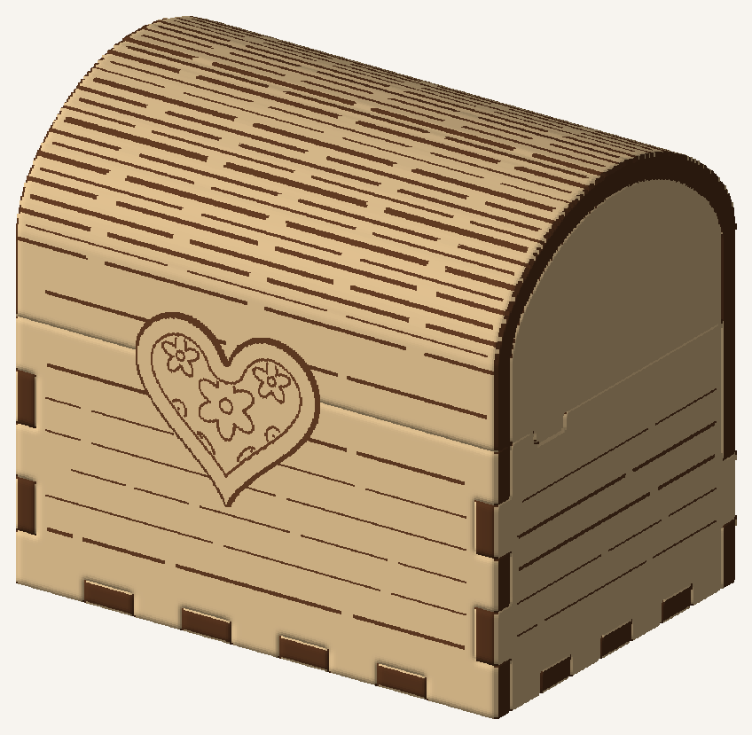
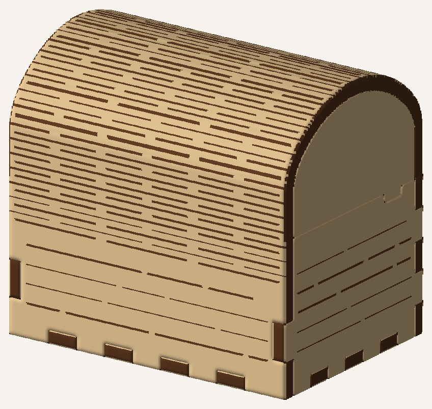
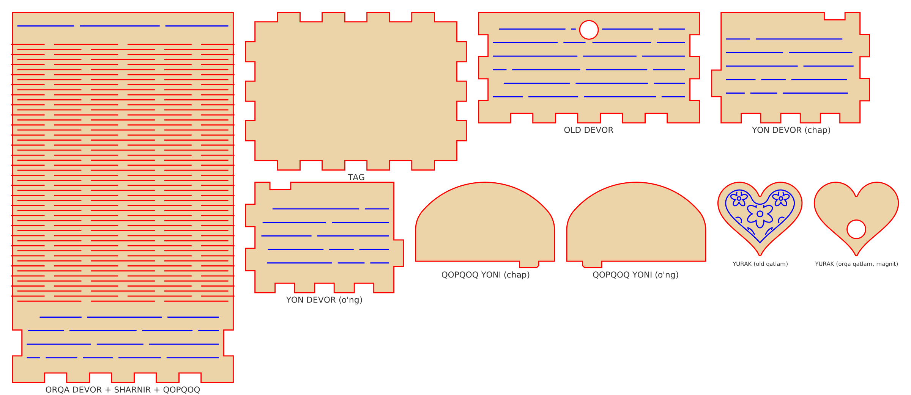

# Sunduk (xazina qutisi) — lazer uchun fayl

Yoysimon egiluvchan qopqoqli, tishli (finger joint) bo'g'inli, oldida magnitli yurak qulfi bor kichik quti.
Uzuk yoki sovg'a qutisi sifatida ishlatsa bo'ladi. Temir sharnir kerak emas: orqa devor bilan qopqoq
**bitta bo'lak**, ular orasidagi egiluvchan (kesikli) zona sharnir vazifasini bajaradi.

| Old tomondan | Orqa tomondan |
|---|---|
|  |  |



## Fayllar

| Fayl | Nima uchun |
|---|---|
| `sunduk_70x50x63_3mm.svg` | **Kichik** quti (70×50×63 mm), 3 mm material — LightBurn, Inkscape, CorelDraw |
| `sunduk_70x50x63_3mm.dxf` | Xuddi shu, DXF — RDWorks, LaserCut, AutoCAD |
| `sunduk_70x50x63_3mm.pdf` | Xuddi shu, PDF (vektor, 1:1 masshtab) |
| `sunduk_120x85x98_3mm.*` | **Katta** quti (120×85×98 mm), 3 mm material |
| `sunduk_70x50x63_2.8mm.*` | **Kichik** quti, **2.8 mm** material uchun (svg / dxf / pdf) |
| `sunduk_120x85x98_2.8mm.*` | **Katta** quti, **2.8 mm** material uchun (svg / dxf / pdf) |
| `*_chizma.png`, `*_3d_*.png` | Faqat ko'rish uchun rasmlar (kesmang!) |
| `sunduk.py` | Generator: istalgan o'lcham/qalinlikka qayta chizadi |

Ranglar (DXF da qatlamlar):

- 🔴 **qizil** `#FF0000` — kesish (`CUT` — detallar konturi, `KERF` — egiluvchan kesiklar)
- 🔵 **ko'k** `#0000FF` — gravirovka / chiziq (`ENGRAVE` — taxta naqshi va yurakdagi gul).
  Kerak bo'lmasa, bu qatlamni o'chirib qo'ying.

Kesish varag'i: kichigi 290×126 mm, kattasi 482×198 mm.

## Kerakli narsalar

- 3 mm **fanera** (qayin faneri yaxshi egiladi). MDF ham bo'ladi, lekin egiluvchan joyi mo'rtroq.
- 2 dona **neodim magnit**: kichik qutiga 6×3 mm, katta qutiga 8×3 mm.
- Yog'och kleyi (PVA / stolyar kleyi), qog'oz skotch yoki rezinka.

## Kesishdan oldin

1. **Material qalinligini o'lchang.** 3 mm bo'lmasa (masalan 3.2 yoki 4 mm), faylni qayta yarating (pastda).
2. Lazer sozlamasini (quvvat/tezlik) o'z stanogingizga moslang. Avval kichik detalni sinab kesing.
3. Kontur ichidagi detallar (teshiklar, kesiklar) konturdan **oldin** kesilsin (LightBurn buni o'zi qiladi).
4. Tishlarga lazer nuri eni uchun 0.1 mm qo'shilgan. Tishlar bo'sh bo'lsa `--kerf 0.15`,
   juda tor bo'lsa `--kerf 0.05` bilan qayta yarating.

## Yig'ish

Detallar: **TAG**, **OLD DEVOR**, 2 ta **YON DEVOR**, uzun **ORQA DEVOR + SHARNIR + QOPQOQ**,
2 ta **QOPQOQ YONI**, 2 qatlamli **YURAK**.

1. **Korpus.** Tag, old devor, ikkala yon devor va uzun bo'lakning pastki (tishli) qismini tishlari bo'yicha
   yopishtiring. Gravirovka qilingan yuzalar tashqariga qarasin.
   ⚠️ Uzun bo'lakda kesiklar boshlanadigan joydan yuqorisi (orqa devorning yuqori ~10 mm qismi) — **sharnir**.
   U yerga kley **surtmang**, aks holda qopqoq ochilmaydi.
2. **Qopqoq.** Qopqoq yonlarini korpus ustiga qo'ying: pastidagi kichik tishcha yon devordagi o'yiqqa
   tushsin (tishcha oldinga qaraydi). Uzun bo'lakning kesikli qismini ularning yoyi ustidan egib,
   **yoy va oldingi tik qism** bo'ylab yopishtiring. Qopqoqning orqa tik qismi (sharnir zonasi) yopishtirilmaydi.
   Qurigunicha skotch bilan o'rab qo'ying. Qopqoq yonlarini korpusga yopishtirib qo'ymang!
3. **Magnit.** Bitta magnitni old devordagi teshikka yopishtiring. Ikkinchisini yurakning orqa qatlamidagi
   teshikka qo'ying — **qutblarini tekshiring**, ular bir-birini tortishi kerak. Yurakning ikki qatlamini
   bir-biriga yopishtiring (gulli qatlam oldinda).
4. **Yurak.** Qopqoqni yoping. Yurakning yuqori qismiga (taxminan 9 mm) kley surtib, qopqoq oldiga
   yopishtiring; pastki qismi korpus oldiga osilib turadi. Magnitlar yurakni o'zi to'g'ri joyga tortadi.

Qopqoq orqaga ochiladi, yopilganda magnit ushlab turadi.

## Boshqa o'lcham yoki material

Python 3 va kutubxonalar kerak: `pip install shapely ezdxf numpy cairosvg` (3D tekshiruv uchun `scipy matplotlib`).

```bash
python3 sunduk.py
```

```bash
python3 sunduk.py --W 120 --D 85 --H 55 --lid_straight 14 --lid_rise 26 --corner_r 15 --hinge_below 12 --magnet_d 8
```

```bash
python3 sunduk.py --T 4 --corner_r 12 --kerf 0.15 --check
```

Asosiy parametrlar (mm):

| Parametr | Ma'nosi | Standart |
|---|---|---|
| `--W` `--D` `--H` | tashqi eni, chuqurligi, korpus balandligi | 70, 50, 35 |
| `--T` | material qalinligi | 3 |
| `--lid_straight` | qopqoqning tik qismi | 10 |
| `--lid_rise` | qopqoq yoyining balandligi (`corner_r` < `lid_rise` < (D−2T)/2) | 15 |
| `--corner_r` | qopqoq burchagi radiusi | 9 |
| `--hinge_below` | sharnirning korpusdagi qismi | 10 |
| `--kerf` | lazer nuri eni kompensatsiyasi | 0.1 |
| `--kerf_pitch` | egiluvchan kesiklar orasidagi masofa (kichikroq = yumshoqroq) | 1.6 |
| `--magnet_d` | magnit diametri | 6 |
| `--no-engrave` | gravirovkasiz | — |
| `--check` | 3D tekshiruv (detallar bir-biriga kirmasligi, tirqish yo'qligi) + 3D rasm | — |

Qopqoq qattiq egilsa yoki yorilsa, `--kerf_pitch 1.3` bilan qayta yarating.
